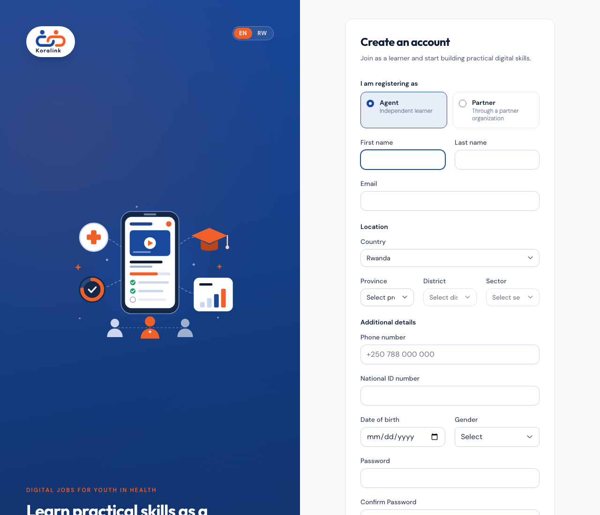

# Getting Started

## Visiting the platform

You do not need an account to look around. As a visitor you can open the home page, browse the **Courses** and **Bundles** pages, read a course page, and open the **About** and **Contact** pages. To enroll in a course or study a lesson you must create an account and log in.

The main menu at the top of the page contains **Home**, **Courses**, **Bundles**, **About** and **Contact**. Visitors also see **Log in** and **Explore Courses**. On a phone, tap the menu button to open the same links plus **Register**.

## Choosing your language

The platform offers **English** and **Kinyarwanda**. Use the **EN** and **RW** buttons in the top bar (on a phone, open the menu and find "Language"). The current language is highlighted. When you press a button, the page reloads in the chosen language and you stay on the same page.

### What language you see on your first visit

A brand-new visitor who has not chosen a language sees the platform's starting language. In the standard setup this is English, but the site owner can configure a different starting language. After you choose a language yourself, your choice always wins over the starting language.

### How your choice is remembered

Your choice is remembered in three ways:

* For the current visit.
* In a browser cookie that lasts about one year, so it survives logging out and closing the browser.
* On your account, once you are logged in, so it follows you to other devices.

When several of these exist, the language saved on your account is used first, then the current visit, then the cookie. If you pick a language before logging in and your account has no language saved yet, your account adopts that choice. When you register, the language you were viewing at the time is saved on your new account.

> Note: Anything that has not been translated is shown in English.

## Registering

1. Open the menu and choose **Register** (or choose **Sign up as a learner** on the login page).
2. Under **I am registering as**, choose your learner type. See "Choosing your learner type" below.
3. Fill in **First name** and **Last name**.
4. Enter your **Email**. It must not already be used by another account.
5. Under **Location**, choose your **Country**. See "Location" below.
6. If you are registering as an Agent, you may fill in the optional **Additional details**.
7. Enter a **Password** and type it again in **Confirm Password**. Use at least 8 characters.
8. Choose **Register**.

If something is wrong, the form stays open and shows a message under the field to correct. When registration succeeds you are logged in immediately and taken to your learner dashboard (or back to the course you were looking at, see below).

### Choosing your learner type

* **Agent** ("Independent learner") is selected by default.
* **Partner** ("Through a partner organization") appears only when at least one partner organization is currently active. If you do not see it, no organization is available to join.

### Registering as a Partner

1. Choose **Partner**.
2. Under **Partner organization**, open the list ("Select your organization") and choose your organization.
3. Enter the **Organization access code**. Your organization gives you this code ("Ask your organization for its access code.").
4. Complete the rest of the form as usual.

The access code is not case-sensitive, and spaces before or after it are ignored. If it is missing or wrong for the organization you chose, you will see: "The access code is missing or incorrect for the selected organization." Ask your organization to confirm the code. An organization that has no code set up cannot accept new learners.

> Tip: If you start from a partner-only course page and choose **Register**, the form opens with **Partner** and the right organization already selected. After you register you are brought back to that course.

### Optional details for Agents (identity details)

Agents can supply these details. All four are optional, and they are shown only when **Agent** is selected. Partners do not have these fields.

| Field | What to enter |
|-------|---------------|
| Phone number | For example `+250 788 000 000`. Message if invalid: "Enter a valid phone number, e.g. +250 788 000 000." |
| National ID number | 6 to 32 letters and digits. Spaces and hyphens are removed automatically. Message if invalid: "The national ID number may contain only letters and digits (6 to 32 characters)." |
| Date of birth | A date in the past. Message if invalid: "Date of birth must be in the past." |
| Gender | Choose **Male**, **Female**, **Other** or **Prefer not to say**. |

On the profile page these details are described as "Used to verify your identity as an Agent."

### Location

* **Country**: Rwanda, Burundi, Democratic Republic of the Congo, Kenya, Tanzania, Uganda or Other.
* If you choose **Rwanda**, you must also choose **Province**, **District** and **Sector**, in that order. Each list depends on the previous choice. If a choice does not match, you will see messages such as "Please select a valid province."
* For any other country, province, district and sector are not needed.

### Email verification

The registration and login pages do not require you to confirm your email address. In the current setup you can use the platform straight after registering.

The platform does contain a "verify your email" page ("Thanks for signing up! Before getting started, could you verify your email address by clicking on the link we just emailed to you?") with a **Resend Verification Email** button and a **Log Out** link. If you ever see that page, use the link in the email, or press the button to receive a new one.

> Note: If you change your email address on the profile page, your email is marked as not verified. This does not block you from learning.

## Logging in

1. Choose **Log in**.
2. Enter your **Email** and **Password**.
3. Tick **Remember me** if you want to stay logged in on this device.
4. Choose **Log in**.

After logging in you go to your learner dashboard. If you were sent to the login page while trying to do something (for example, enrolling in a course), you see "Sign in or create an account to continue (for example, to enroll in a course)." and, after logging in, you are taken back to where you were.

Possible problems:

* Wrong email or password: "These credentials do not match our records."
* Too many failed attempts (five): "Too many login attempts. Please try again in :seconds seconds." The message shows the number of seconds to wait.
* Account switched off by an administrator: "This account has been deactivated. Contact an administrator."

## Logging out

Choose **Log out** in the top menu (on a phone, open the menu first). You return to the home page.

## Resetting a forgotten password

1. On the login page choose **Forgot your password?**
2. Enter your email address and choose **Send Reset Link**.
3. You will always see the message: "If an account exists with that email address, we've sent a password reset link." The same message appears whether or not the address is registered.
4. Open the email and follow the link. The link stays valid for 60 minutes.
5. On the **Reset password** page, enter your email, a **New password** (at least 8 characters) and **Confirm new password**, then choose **Reset Password**.
6. You are taken to the login page with the message "Password reset successfully. You can now sign in using your new password."

If the link is old or has already been used, you see "This password reset link is invalid or has expired." Choose **Request New Reset Link** to get a new one.

> Tip: If the email does not arrive, check your spam folder, then request a new link. If it still does not arrive, use the contact form (chapter 6).
