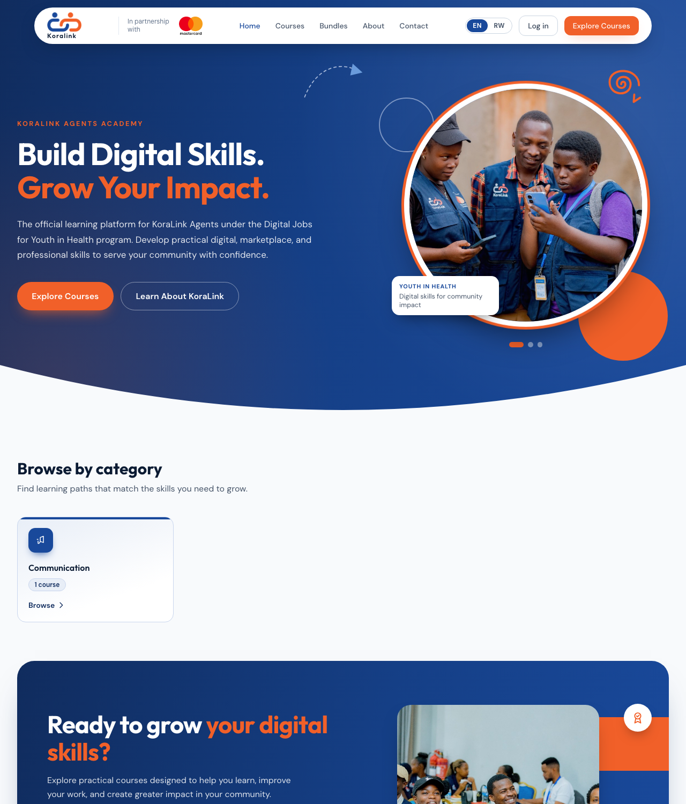
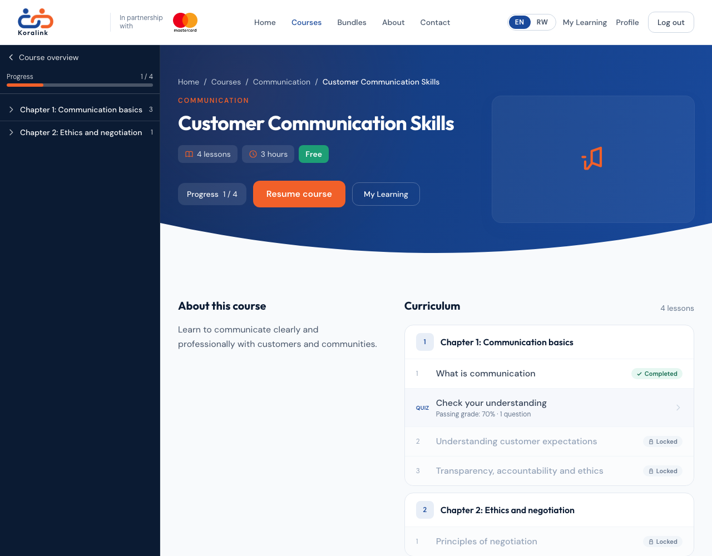

# Finding and Enrolling in Courses

## The home page

The home page gives an overview of the Academy. From top to bottom you will find:

* A welcome banner with the buttons **Explore Courses** and **Learn About KoraLink**.
* **Browse by category**: one card per category with a **Browse** link that opens the catalogue filtered to that category.
* **Start Learning Today**: the six most recently published courses, with a **View All Courses** link.
* **How KoraLink Academy Works**: four steps (Create Your Account, Explore Courses, Learn at Your Pace, Complete & Grow).
* A short description of the program, some figures (learners, courses, categories, enrollments) when available, and the logos of partners under **Our Partners**.

## The course catalogue

Choose **Courses** in the main menu (or **View All Courses**) to see every published course, newest first, 12 per page. Use the page links at the bottom to move between pages.

Each course card shows:

* The course image, its category and either **Free** or a price badge.
* Title and a short description.
* The instructor, the duration (or "Self-paced") and the number of lessons.
* A **View course** link.

### Categories and filtering

Above the list, **Filter by category** shows **All courses** and one button for each category. Choose a category to show only its courses; the page title then reads "<Category> Courses". Choose **All courses** (or **View all courses**) to remove the filter.

> Note: The catalogue has no search box and no other filters. Categories are the only way to narrow the list.

If nothing matches you see "No courses found".

## Course pages

Select a course to open its page. It shows:

* A breadcrumb trail, the category, duration, the instructor, and either **Free** or a price.
* **About this course**: the course description.
* **Curriculum**: every chapter with its lessons, and the quizzes that belong to the course.
* **Upcoming live sessions**, if any are scheduled (see chapter 6).
* **Quizzes**: quizzes that apply to the whole course.
* A banner action area whose content depends on who you are (see below).

If you are not enrolled, each lesson in the curriculum shows "Enroll to access". If the course is not available for your account it shows "Not available for your account" instead.

### Course access levels

Every course is open to one audience. The audience is shown as a small label on the course ("All learners", "Agents only", "All Partners" or "<Organization> only").

| Access level | Who can enroll |
|--------------|----------------|
| All learners | Everyone with an account, Agents and all Partners. |
| Agents only | Agent learners. |
| All Partners | Learners registered as Partners, from any organization. |
| One partner organization | Only Partners registered with that organization. |

Courses for other groups remain visible so you can read about them, but you cannot enroll in them.

### The "Enrollment not available" warning

When a course is not meant for you, the enroll button is replaced by an orange box titled **Enrollment not available**, with one of these messages:

* If you are not logged in: "This course is for Partners only. Log in with an eligible account to enroll." The box offers **Log in** and **Register**. The **Register** button opens the Partner sign-up with the organization selected where it applies.
* If you are logged in: "This course is for Partners only. Your account (Agent) can't enroll in it."

The audience name changes with the course: "Agents only", "Partners only", or, for a single organization, for example "SFH partner learners only". The name in brackets after "Your account" shows your own category, such as "Agent", "Partner" or "Partner (Organization name)".

You cannot get around this: if you try to open one of its lessons directly you are sent back to the course page with the same message.

## Enrolling in a course

1. Log in (you will be asked to if you are not).
2. Open the course page.
3. Choose **Enroll in this course**.

If you were not logged in, you are taken to the login page and then returned to the course. After you enroll:

* If the course has lessons, you are taken to the first lesson with the message "You are enrolled! Let us start with the first lesson."
* If it has no lessons yet, you stay on the course page with "You are enrolled! This course has no lessons yet."

If you are already enrolled you see "You are already enrolled."

> Note: Some courses show a price. The platform does not collect payment; enrolling is done only with the **Enroll in this course** button.

> Note: If a course is free and you open one of its lessons by its direct link without enrolling, you are enrolled automatically. For a course that shows a price, opening a lesson link first sends you to the course page with "Please enroll in this course first."

### After you enroll

On the course page the banner now shows your **Progress** (for example 3 / 12 lessons), a **Start course** or **Resume course** button that opens the next lesson you have not finished, and a **My Learning** link. When every lesson is finished you see **Course completed**.

## Bundles

A bundle is a learning path: several related courses grouped together. Enroll once and you are enrolled in all of its courses.

### Browsing bundles

Choose **Bundles** in the main menu. Each bundle card shows its name, the number of courses and a **View bundle** link. The bundle page lists **Courses in this bundle**, each with a **View** link (or **Open** once you are enrolled) and a description under **What you'll get**.

### Enrolling in a bundle

1. Log in and open the bundle page.
2. Choose **Enroll in this bundle**.
3. You see "You are enrolled! You now have access to all courses in this bundle."

Things to know:

* Only the published courses of the bundle are included.
* Courses that are not meant for your account (for example another organization's Partner course) are skipped. You are enrolled in the rest.
* If none of the courses are available to you, nothing happens and you see "None of the courses in this bundle are available for your learner category."
* If you are already enrolled you see "You are already enrolled in this bundle."
* If you were already enrolled in a course in the bundle, it is not duplicated.

The bundle page then shows your progress: how many courses you have completed out of the total, with a percentage. A course counts as completed when you have finished all its lessons. When all are done you see **Bundle completed**.

## My courses

Choose **My Learning** in the top menu to open **My Courses**. It lists the courses you are enrolled in (most recent first, 12 per page). Each card shows the category, the title, a progress bar and a status:

* **Not started**, with the button **Start**.
* **In progress**, with the button **Resume**.
* **Completed**, with the button **View course**.

If you have no enrollments you see "No courses yet" and a **Browse courses** button. Only published courses appear here.

## My bundles

Open **My Bundles** from the **My bundles** card on your dashboard. It lists your bundles with the number of completed courses out of the total, a progress bar, and a **Continue** button. With no bundles you see "No bundles yet" and a **Browse bundles** button.
