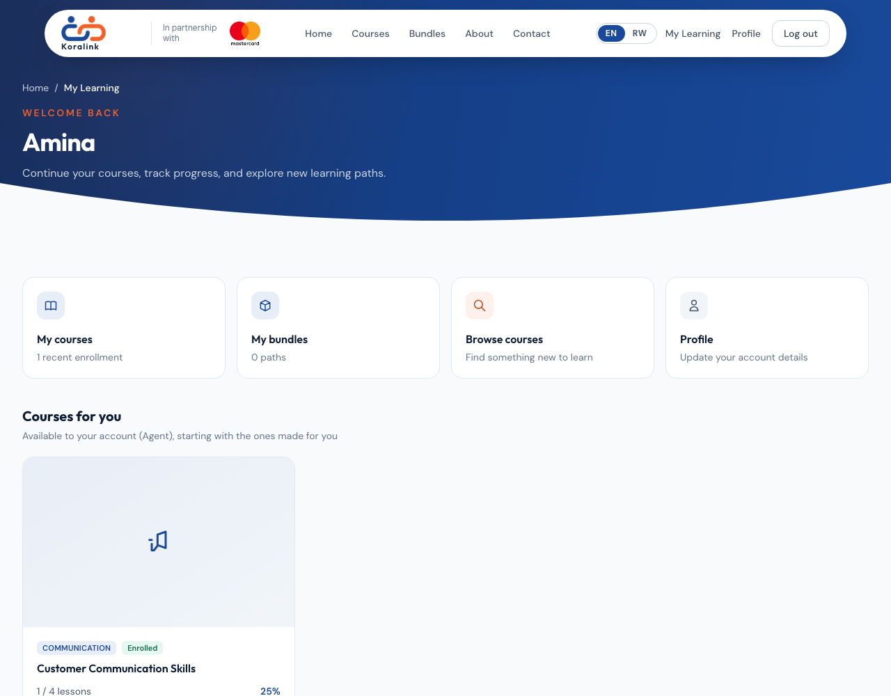
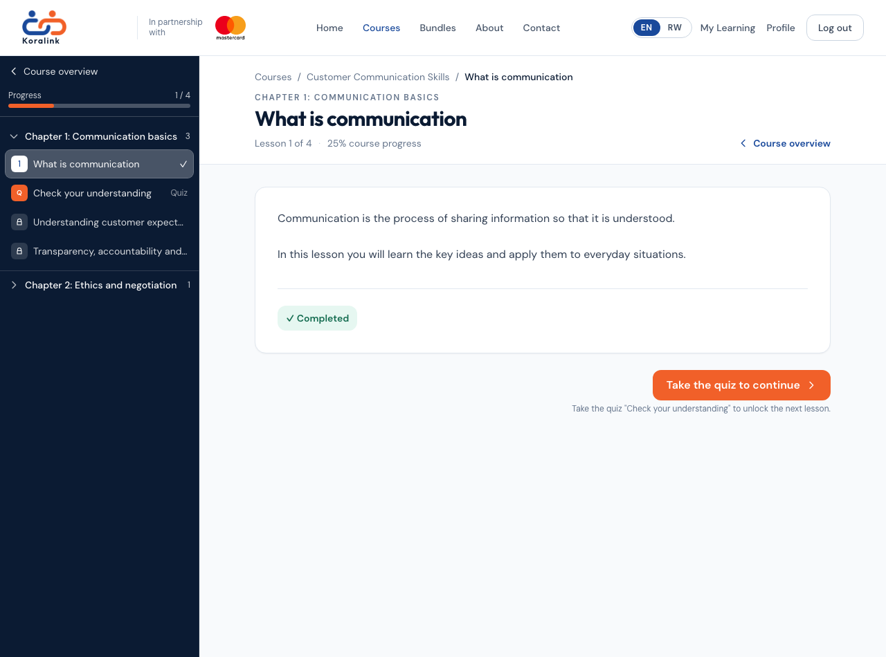

# Learning

## Your dashboard

After you log in you land on your dashboard, headed "Welcome back" with your first name. It is also reached through the "My Learning" breadcrumb. The page has four shortcut cards and several sections. Sections appear only when they have something to show.

**Shortcut cards**

| Card | Where it leads |
|------|----------------|
| My courses | The list of your enrolled courses. |
| My bundles | The list of your bundles. |
| Browse courses | The course catalogue ("Find something new to learn"). |
| Profile | Your profile ("Update your account details"). |

**Sections**

| Section | What it shows |
|---------|---------------|
| "<Organization> courses" | Partner learners only. Courses selected for your own organization ("Selected for your organization"). |
| Courses for you (or **Other courses** when you also have organization courses) | Courses you may take: first the ones made for your category (Agents or Partners), then those open to everyone. Up to 12 are shown. |
| **Continue learning** | "Pick up where you left off." Your enrolled courses with progress ("3 / 12 lessons") and a **Start**, **Resume** or **View** button. If you have no enrollments it says "No courses yet" with a **Browse courses** button. |
| **Bundle progress** | "Share of courses completed in each learning path", with a **View all bundles** link. |
| **Courses for other groups** | "Made for other groups. You can read about them but not enroll." |

> Note: The **My Learning** link in the top menu opens the **My Courses** list. The dashboard is where you arrive after logging in.

Administrators who log in are sent to the administration area instead of this dashboard.

## The course curriculum

On a course page, the **Curriculum** lists chapters in order, each with its numbered lessons. Quizzes appear beneath the lesson they follow, or at the end of a chapter, or in the **Quizzes** section for the whole course.

Once you are enrolled, every lesson carries a status, explained in "Lesson order and locking" below.

## Opening a lesson

Choose a lesson from the curriculum, or press **Start course** / **Resume course**. The lesson page has:

* A breadcrumb, the lesson title, "Lesson 3 of 12" and "25% course progress", and a **Course overview** link back to the course page.
* A **curriculum sidebar** (on a phone it is stacked above the lesson) with the course progress, **Course overview**, each chapter (click a chapter to open or close it), and the status of each lesson and quiz. The lesson you are on is highlighted.
* The lesson itself.
* **Previous** and **Next lesson** buttons at the bottom. On the last lesson the button is **Back to course**.

### Lesson types

| Type | What you see |
|------|--------------|
| Text | The lesson text. |
| YouTube | A video picture with a play button. Press play to start the video inside the page. Any additional text appears below. |
| PDF | A button, **Download / View PDF** (or **Open PDF**), that opens the document. |
| Uploaded video | A video player. Your browser must support video playback. |

If the teacher has not yet added the content you see "Lesson content will be added soon." If a file is missing you see "No playable YouTube video was found for this lesson.", "No PDF file available." or "No video file available."

### How lessons are completed

There is no "mark as complete" button. A lesson is completed automatically:

| Lesson type | It is marked complete when |
|-------------|----------------------------|
| Text | You have stayed on the page at least 5 seconds and scrolled to the end of the lesson. A short lesson that fits the screen is completed after about 5 seconds on the page. |
| PDF | The same rule as text: at least 5 seconds on the page and the end of the page reached. Opening the PDF itself is not tracked. |
| YouTube | The video plays to the end. Starting the video with the play button is required. |
| Uploaded video | The video is 90% watched, or ends. |

Under the lesson you see the instruction "This lesson is marked complete automatically once you have read it." or, for videos, "This lesson is marked complete automatically when you finish watching the video." When it is recorded the message changes to **Completed** and the progress figures update. If saving fails you see "Could not save your progress. Please reload the page."

> Tip: For a YouTube lesson, do not skip to the end by closing the page. Let the video finish while you are on the lesson page so that it is recorded.

## Lesson order and locking

By default, lessons must be completed in order. Each lesson shows one of three statuses, on the course page, in the sidebar and at the top of the lesson:

| Status | Meaning |
|--------|---------|
| **Completed** | You finished the lesson. You can reopen it at any time. |
| **In progress** | The lesson is open and not finished yet. This is normally the next lesson after the last completed one. |
| **Locked** | You cannot open it yet. In the curriculum it is greyed out ("Locked until the previous lesson is completed"). |

The rules are:

* The first lesson is always open.
* A lesson opens when the lesson before it (in chapter and lesson order, continuing across chapters) is completed.
* A lesson you have already completed stays open, even if earlier ones were skipped.
* If you try to open a locked lesson by its link, you are sent to the lesson you must finish first with the message: "This lesson is locked. Finish ":lesson" first to unlock it." (the lesson's title appears in place of ":lesson").

> Note: A course can be set up so that lessons may be taken in any order. In that case nothing is locked and the Locked status does not appear. Staff accounts are never locked out.

### The Next lesson button

At the bottom of each lesson the **Next lesson** button works like this:

* If the next lesson is locked because you have not finished the current one, the button is grey and disabled, with "Complete this lesson to unlock the next one." It becomes active as soon as the lesson is recorded as completed.
* If the lesson has a quiz that you must take, see the next section.
* On the last lesson the button is replaced by **Back to course**.

### A quiz under a lesson

A teacher can place a quiz directly under a lesson. When that happens, the next lesson stays locked until you have completed the lesson **and** taken the quiz:

* While the lesson is not completed, the button is disabled with "Complete this lesson and take its quiz to unlock the next one."
* Once the lesson is completed, **Next lesson** is replaced by **Take the quiz to continue**, with "Take the quiz ":quiz" to unlock the next lesson."
* "Taken" means you submitted the quiz at least once. You do not need to pass. A quiz you started but did not submit does not count.
* If you try to open the next lesson directly, you are sent to the quiz with "Take the quiz ":quiz" first to unlock the next lesson."
* Only published quizzes hold a lesson back.

### When a quiz is locked

A quiz is itself locked until you have completed the lessons that come before it. Which lessons are required depends on where the quiz sits:

| Quiz position | Lessons you must complete first |
|---------------|---------------------------------|
| Under a lesson | Every lesson up to and including that lesson. |
| At the end of a chapter | Every lesson up to the end of that chapter. |
| For the whole course (**Quizzes** section) | Every lesson in the course. |

A locked quiz is greyed out with "Locked until the lessons before it are completed". If you open it anyway you are sent to the first lesson you still need with: "This quiz is locked. Finish ":lesson" first to unlock it."

## Progress

* On the course page: "Progress 3 / 12" (lessons completed out of the total), and **Course completed** at the end.
* On a lesson page: "Lesson 3 of 12" and a percentage ("25% course progress"), calculated as completed lessons divided by total lessons.
* On **My Courses** and the dashboard: a progress bar and a status of **Not started**, **In progress** or **Completed**.
* For bundles: completed courses out of the total, with a percentage.

Your progress is saved on your account, so you can continue from any device. The platform does not issue certificates.
