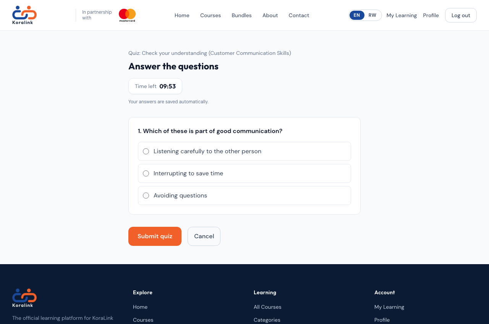

# Quizzes

Quizzes let you check what you have learned. Every question has several answer options and you choose exactly one. Each question is worth a number of points, and your score is the total of the points for the questions you answered correctly.

## Finding a quiz

Quizzes appear in the course curriculum, marked **Quiz**, with the passing grade and the number of questions ("Passing grade: 70% · 5 questions"). You must be enrolled to open a quiz, and the lessons before it must be completed (see chapter 4). Only published quizzes are shown.

## The quiz overview page

Opening a quiz shows its title, description and the rules:

* **Questions**: how many there are.
* **Passing grade**: the percentage you need to pass.
* **Time limit**: shown only if the quiz has one.
* **Attempts**: for example "Attempts: 1 of 3 used", or "Attempts: 1 used (no limit)".
* "You cannot retake this quiz after passing it." if that rule applies.

The main button depends on your situation:

| Button | When |
|--------|------|
| **Start quiz** | You have not tried this quiz yet. |
| **Retake quiz** | You have finished an earlier attempt and may try again. |
| **Resume quiz** | You have an unfinished attempt ("You have an unfinished attempt. Pick up where you left off."). |

If you have already submitted before, **View your last result** takes you to your latest result.

## Taking a quiz

1. Choose **Start quiz**.
2. Read each numbered question and select one answer. Every question must be answered before the form can be submitted, unless time runs out (see below).
3. Choose **Submit quiz** when you are done.

**Cancel** takes you back to the course page without submitting. The attempt stays open and you can resume it later. If the quiz has a time limit, the clock keeps running while you are away.

### Autosave

The page shows "Your answers are saved automatically." Your answers are sent to the platform a moment after each change, every 15 seconds, and when you switch to another tab. If you close the browser or lose power, open the quiz again and choose **Resume quiz** to find your saved answers in place.

### Time limit

If the quiz has a time limit, a **Time left** countdown shows minutes and seconds. It turns red during the last minute. The countdown runs from the moment you start, measured by the platform's clock, not by your device.

When the time reaches zero, the page submits automatically with the answers you have given. The platform also closes the attempt itself if the deadline has passed: it submits the answers that were last saved, and anything sent after the deadline (with a short allowance of 20 seconds for slow connections) is not graded. Unanswered questions score zero.

On the result page you will then see either "The time limit ran out, so the answers you had saved were submitted automatically." or, if nothing was saved, "The time limit ran out, so this attempt was closed without answers." If you open an expired attempt you see "Time is up. Your attempt was closed."

### Maximum attempts and retaking

Teachers set the rules for each quiz.

* **Maximum attempts**: the quiz may allow a fixed number of attempts, or unlimited attempts. Only submitted attempts count, including those closed by the time limit. When all are used you see "You have used all :max attempts for this quiz." (with the number filled in).
* **Retaking after passing**: some quizzes can be retaken even after you passed; others cannot. When retaking is not allowed and you have passed, you see "You already passed this quiz and cannot retake it." You can still view your result. If you failed, you may try again as long as you have attempts left.
* Pressing **Start quiz** twice quickly does not use up two attempts. You are simply taken to the same attempt.

## Results

When you submit you see "Quiz submitted." and the **Quiz result** page:

* Your score as points ("8 / 10") and as a percentage ("80%").
* **Passed** or **Not passed**, based on the **Passing grade** shown below it. You pass when your percentage is equal to or higher than the passing grade.
* **Your answers**: each question with "You chose:" and your answer marked **Correct** or **Incorrect**, or **No answer** if you skipped it.
* A **Back to course** button.

The result page shows which of your answers were wrong, but it does not show what the correct answer was.

If you open the page of an attempt you already submitted, you are taken to the result with "You already submitted this attempt."

> Note: Submitting a quiz, whether you pass or not, is what unlocks the next lesson when the quiz sits under a lesson (chapter 4).
