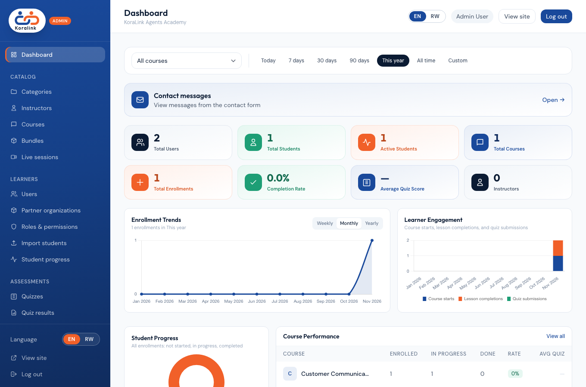

# Administrator Guide: Overview

This guide explains how staff and administrators of KoraLink Academy use the admin panel to manage courses, learners, quizzes and site content. It is written for non-technical users: every procedure is a short list of steps using the labels you see on screen.

## Who can use the admin panel

The admin panel is available at the `/admin` address of the site. You can open it only if both of these are true:

- Your account is **active**.
- Your account is either a **Super Admin** or has a **staff role** assigned to it (see the roles chapter of this guide).

Ordinary learners (accounts with no role) who try to open `/admin` see an "Access denied" page. A deactivated account cannot sign in at all and sees the message "This account has been deactivated. Contact an administrator."

What you see inside the panel depends on your permissions. A staff member only sees the menu entries for the modules they are allowed to view, and buttons such as Create, Edit or Delete appear only when the matching permission is granted. If you open a page you have no permission for, you get "You do not have permission to access this module."

## Signing in

1. Go to the site and choose to sign in.
2. Enter your email address and password.
3. After a successful sign-in, staff are taken straight to the admin Dashboard. Learners are taken to their own learner dashboard. (If you were sent to the sign-in page from a specific page, you return to that page instead.)

If your role does not include permission to view the Dashboard, you are redirected to the first page in the menu that you are allowed to open.

Tip: If you forget your password, use the "Forgot password" link on the sign-in page.

## Layout of the panel

The panel has a dark navigation menu on the left (opened with a menu button on phones and small screens) and the page content on the right.

At the bottom of the menu you will find:

- **Language** switcher (English and Kinyarwanda). This changes the language of the interface labels. Content you type into forms stays in the language you entered it in.
- **View site**: opens the public website.
- **Log out**.

The top of each page shows the page title and, on the right, **View site** and **Log out** buttons.

### Navigation groups

Menu entries are grouped as shown below. A group, or an entry within it, is hidden if you do not have View permission for that module.

| Group | Entries |
| --- | --- |
| (no heading) | Dashboard |
| Catalog | Categories, Instructors, Courses, Bundles, Live sessions |
| Learners | Users, Partner organizations, Roles & permissions, Import students, Student progress |
| Assessments | Quizzes, Quiz results |
| Analytics | Reports & Analytics |
| Site | Settings, Contact messages, Partner logos |
| Help | Documentation |

Note: "Contact messages" sits under the same permission as Settings. Anyone who can view Settings can also read the contact messages.

**Documentation** (under Help) is where administrators read this User Guide and the System Documentation online and download them. **Download PDF** opens a print-ready page; in the print window choose **Save as PDF** as the destination. **Download (HTML, printable)** saves a self-contained page and **Download (Markdown)** saves one Markdown file. Access is controlled by its own permission, so staff roles need "Documentation: View" to see it.

## The Dashboard

The Dashboard is the first page you see. It summarises activity on the platform for a chosen period and course.

### Filters at the top

- **Course** drop-down: "All courses" or one specific course. When a course is selected, all figures narrow to that course.
- **Period** buttons: Today, 7 days, 30 days, 90 days, This year, All time, or Custom. With Custom, pick a From and To date and press **Apply**.
- The **Weekly / Monthly / Yearly** switch above the enrollment chart changes how the chart groups its data.

### Contact messages banner

A banner shows how many messages from the public contact form are unread and the total. Click it to open the inbox.

### Key metrics (KPI cards)

Each card is clickable and opens the related page. Cards that can be compared show a percentage change against the previous period of the same length.

| Card | What it means |
| --- | --- |
| Total Users (or "Unique users" when a course is selected) | All accounts, including staff, created up to the end of the period. |
| Total Students (or "Students enrolled") | Accounts without admin access, created up to the end of the period. With a course selected: students enrolled in it. |
| Active Students | Students who were active in the period: they signed in, completed a lesson, submitted a quiz, or enrolled. |
| Total Courses (or "Selected course") | Number of courses (1 when a course is selected). |
| Total Enrollments | New enrollments created during the period. |
| Completion Rate | Of the enrollments created in the period, the percentage whose learner has completed every lesson. Shows a dash when there were no enrollments. |
| Average Quiz Score | Average percentage of quiz attempts submitted in the period. Shows a dash when there were none. |
| Instructors | Number of instructors (or those teaching the selected course). |

### Charts and tables

- **Enrollment Trends**: number of enrollments over the period.
- **Learner Engagement**: course starts, lesson completions and quiz submissions over the period.
- **Student Progress**: all enrollments split into Not started, In progress and Completed.
- **Course Performance**: for each course, Enrolled, In progress, Done, completion Rate and Avg quiz score.
- **Quiz Performance** and **Assessments**: average score and pass rate per quiz, with the lowest-performing quizzes highlighted.
- **Courses Requiring Attention**: courses with a completion rate below 30% (once they have at least 3 enrollments), an average quiz score below 50% (once they have at least 3 submitted attempts), or no recent activity in the selected period.
- **Live Sessions**: upcoming and recently held sessions.
- **Recent Activity** and **Recent Enrollments**: the latest enrollments, course completions, quiz submissions, and newly created courses, live sessions and instructors.

Note: A learner's progress is the share of the course's lessons they have marked complete. Quizzes do not count as lessons in this percentage.
