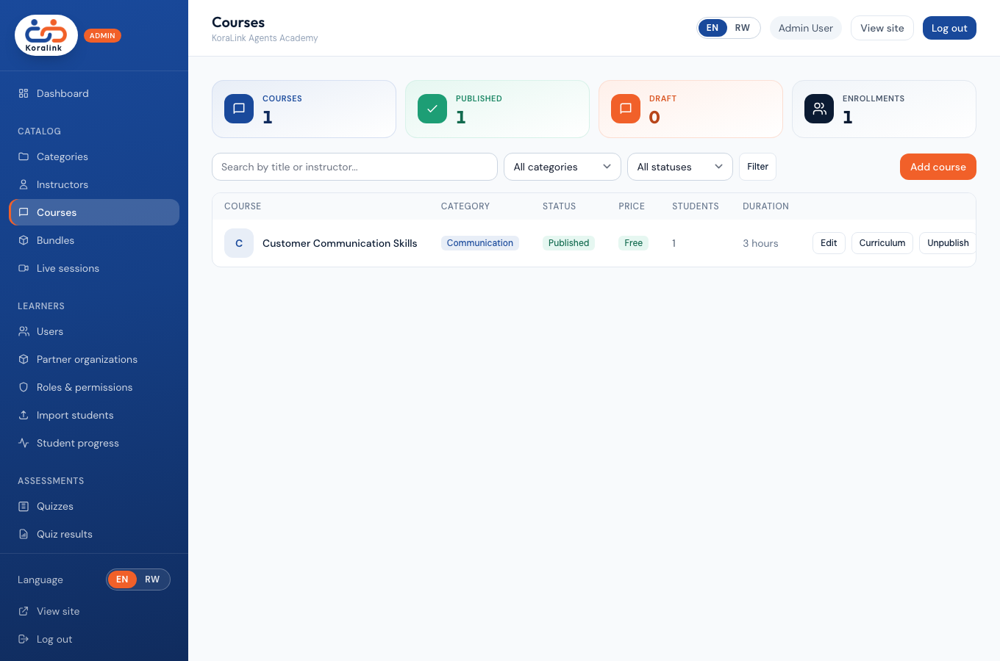

# Administrator Guide: Catalog (Categories, Instructors, Courses, Bundles, Live Sessions)

The **Catalog** group of the menu holds everything learners can browse and study. Each module follows the same pattern: a list page with an overview, a search box and filters, an **Add** button, and **Edit** and **Delete** buttons on each row (shown only if you have the matching permission).

Note: Each form that holds learner-facing text also has an optional "Kinyarwanda translation" section. See the translation section in the "Reports, settings and messages" chapter.

## Categories

Categories group courses on the public site.

1. Open **Categories** and choose **Add Category**.
2. Enter the **Name**.
3. Optionally enter an **Icon** (an emoji or short label, for example a symbol or the word "dev").
4. Choose **Create category**.

The list shows how many courses each category holds. To change a category, choose **Edit**. A course must belong to a category, so create the categories you need before creating courses.

## Instructors

Instructors are the teachers shown on courses.

1. Open **Instructors** and choose **Add Instructor**.
2. Enter the **Name**, and optionally an email and a **Bio**.
3. Choose **Create instructor**.

Assigning an instructor to a course is optional.

## Courses

### The courses list

The list shows each course with its category, status (Published or Draft), price (or Free), duration, access audience and number of students. You can search by title or instructor, and filter by category and status. A "Kinyarwanda translation available" mark appears for courses that have a translation.

Row buttons: **Edit**, **Curriculum**, **Publish** or **Unpublish**, and **Delete**. Deleting a course asks for confirmation.

### Creating a course

1. Open **Courses** and choose **Add course**.
2. Fill in the form:

| Field | Notes |
| --- | --- |
| Category | Required. |
| Instructor | Optional. |
| Title | Required. |
| Description | Optional text shown on the course page. |
| Course type | "Free course (price = 0)" or "Paid course". For a paid course a **Price ($)** field appears. |
| Course banner | Optional cover image. JPEG, PNG, GIF or WebP, up to 2 MB. |
| Duration | Free text, for example "8 hours". |
| Level | Beginner, Intermediate or Advanced. |
| Who can access this course | See "Access level" below. |
| Partner organization | Only used when access is a specific partner organization. |
| Students must complete lessons in order | See "Lesson order" below. |
| Status | Draft or Published. |

3. Optionally open the Kinyarwanda translation section and translate the Title, Description and Duration.
4. Choose **Create course**. You are taken to the course editor with a confirmation to add sections and lessons.

Note: The panel stores a price and uses it in the estimated figures on the Reports page. The admin panel itself has no payment features.

### Status: Draft and Published

- **Draft**: the course is visible only in the admin panel and not on the public site.
- **Published**: the course is live on the public site.

You can set the status in the course form, or use the **Publish** / **Unpublish** buttons on the courses list. Changing a course back to Draft hides it from the public website.

Warning: Publishing is not blocked when a course has no lessons. Check the curriculum yourself before you publish.

### Access level

The field **Who can access this course** controls which learners can see, enroll in and open the course:

| Option | Who can use the course |
| --- | --- |
| All learners (Agents and all Partners) | Everyone (default). |
| Agents only | Learners whose category is Agent. |
| All Partners | Learners whose category is Partner, from any organization. |
| Specific Partner organization | Only Partner learners belonging to the organization you pick in **Partner organization** (required for this option). |

Learners outside the audience do not see the course, cannot enroll and cannot open it by its address. Staff are never restricted. If you narrow the audience after learners have enrolled, those learners keep their access; the confirmation message tells you how many enrolled learners fall outside the new audience. Learner categories are explained in the learners chapter.

### Lesson order ("Students must complete lessons in order")

This switch is on by default.

- **On**: each lesson unlocks only when the previous lesson is completed. The first lesson is always open. If a published quiz is placed after a lesson, the next lesson also waits until the learner has submitted that quiz.
- **Off**: learners can open lessons in any order.

Staff are never locked out of any lesson.

### Editing a course and its curriculum

The course editor has two tabs: **Overview** (the form above and pricing) and **Curriculum**. Choose **Save course** after changes to the Overview. You can replace the banner by uploading a new image; the current banner is shown above the upload field.

### Sections (chapters) and lessons

In the **Curriculum** tab the course is organised as sections, each holding lessons.

To add a section:

1. In the Curriculum tab choose **Add section** (or **Add your first section**).
2. Enter the Chapter title (for example "Introduction") and optionally its translation.
3. Choose **Add section**.

Each section has **Edit**, **Delete** and **Add lesson** buttons. Deleting a section also deletes all its lessons (you are asked to confirm).

To add a lesson:

1. Choose **Add lesson** on the section.
2. Enter the **Lesson title**.
3. Choose the **Content type**. The matching field appears:

| Content type | What you provide |
| --- | --- |
| Text | Text content, up to 10,000 characters. |
| YouTube | A YouTube link in "YouTube (or video) URL". |
| PDF | A PDF file in "Upload PDF", up to 50 MB. |
| Video | A video file in "Upload video": MP4, MOV, AVI or WebM, up to 100 MB. |

4. Optionally add the Kinyarwanda title and text content.
5. Choose **Add lesson**.

When you edit a lesson and upload a new file, it replaces the old file. Deleting a lesson also removes its uploaded file.

### Ordering

New sections are added at the end of the course and new lessons at the end of their section. Learners see them in that order. There is no reordering screen in the panel for sections or lessons, so add them in the order you want learners to follow them.

## Bundles

A bundle groups several courses into one learning path.

1. Open **Bundles** and choose to add a bundle.
2. Enter a **Title**, optional **Slug** (generated from the title if left empty), **Description**, optional **Thumbnail** image (up to 2 MB), and a **Status**: Draft, Published or Archived.
3. Save. You are taken to the bundle editor, where you add courses.

To add a course to the bundle: in "Add course to bundle" choose a course from **Select course** and press **Add**. A course already in the bundle cannot be added twice. The course is placed at the end of the list.

To remove a course: press **Remove** on its row and confirm. This removes it from the bundle only; the course itself is not deleted.

The numbered list "Courses in this bundle (learning sequence)" shows the order learners follow. Courses appear in the order you added them. The panel has no on-screen control to reorder them, so add courses in the sequence you want.

Warning: Removing a course and adding it again places it at the end.

## Live sessions

Live sessions are scheduled online meetings linked to a course. The panel does not host the meeting; you create it in a tool such as Zoom or Google Meet and paste the join link.

1. Open **Live sessions** and choose to add a session.
2. Select the **Course** (required).
3. Enter the **Title**, optional **Description**, **Date & time**, **Duration (minutes)** (between 5 and 480), the **Meeting URL** (must start with https://) and an optional **Meeting password**.
4. Optionally use **Invite students (optional)**: open the list or type to search. Only learners enrolled in that course can be invited.
5. Choose **Create live session**.

Invited students receive an email invitation, and only invited students can see the join link. If the invitation emails cannot be sent, the session is still created and you are told to check the mail settings. When you edit a session and add new invitees, only the newly added people get an email.

The list can be searched and filtered by course, and shows upcoming and past sessions. The session detail page shows the invitees, duration and whether the session is Upcoming, Live now or Past.
