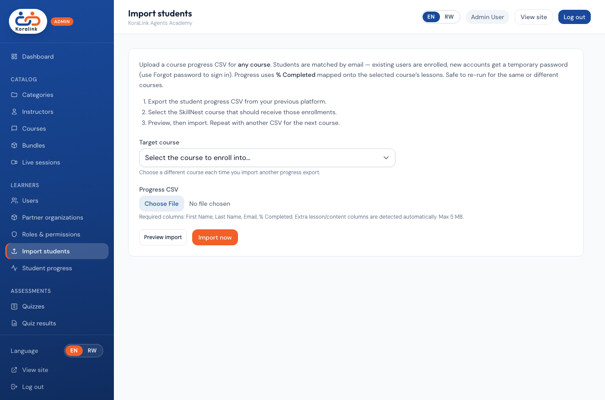

# Administrator Guide: Learners (Users, Partner Organizations, Progress, Import)

The **Learners** group manages the people on the platform and tracks their progress. The **Partner logos** page in the Site group is also covered here.

## Users

Open **Users** to see everyone with an account: learners and staff.

### The users list

At the top, cards show the number of Users, Students, Staff, and either the number of Inactive accounts (if there are any) or accounts that signed in during the last 30 days.

Use the search box (name or email) and the **All roles** and **All statuses** filters, then press **Filter**. The role filter offers Student, Staff, or any specific role. Each row shows the user, role, status, number of enrollments, joined date and last sign-in.

Row actions: **View**, **Edit**, **Activate** / **Deactivate** and **Delete**.

### Learner types

Every learner has a learner category:

| Category | Meaning |
| --- | --- |
| Agent | The default category. |
| Partner | A learner who belongs to a partner organization. A partner organization must be chosen. |

The category controls which restricted courses the learner can see and enroll in (see "Access level" in the Catalog chapter). Learners choose their own category when they register; partners must pick their organization and enter its registration code (see below).

### Creating a user

1. Open **Users** and choose **Add user**.
2. Fill in **First name**, **Last name** and **Email** (must be unique).
3. Set a **Password** and **Confirm password**. The password must meet the platform's password rules.
4. Fill in the **Location**. For Rwanda you can pick province, district and sector; the choices must match each other.
5. Choose the **Learner category**. For Partner, select the **Partner organization**.
6. Choose the **Role / access level**. Leave "Student (no admin access)" for ordinary learners. Choosing a role makes the person staff (see the roles chapter).
7. Leave **Active account** ticked to let the person sign in.
8. Save.

New accounts created here are treated as email-verified.

### Editing a user

Choose **Edit** on a user. The form is the same, except that **Password** is optional: leave it empty to keep the current password. The same page contains the module access section for staff (see the roles chapter).

### Viewing a user

The **View** page shows the user's details and a **User progress** table: for every course on the platform, whether the user is enrolled, how many lessons they have completed, and the status (Not enrolled, Not started, In progress, Completed). Filter it with "All courses" / "Enrolled only" or by searching for a course or category. It may also show optional details the learner entered themselves (phone, national ID, date of birth, gender under "KYC details"), and, for staff, the module access they have.

### Activating, deactivating and deleting

- **Deactivate** blocks sign-in immediately. The account and its history stay. Use **Activate** to restore it.
- **Delete** removes the account permanently after you confirm. It cannot be undone.

Safeguards: you cannot deactivate or delete your own account, and the last active Super Admin cannot be deleted, demoted or deactivated.

## Partner organizations

Partner organizations are the companies or programs whose learners register as Partners.

### Adding an organization

1. Open **Partner organizations** and choose **Add organization**.
2. Enter the **Organization name** (must be unique).
3. Leave **Active (learners can register under it)** ticked.
4. Save.

A **registration code** is generated automatically. It uses easy-to-read characters (no 0/O or 1/I/L) and is shown in the **Registration code** column of the list, next to the organization's number of learners and courses, and its status (Active or Inactive).

### How learners use the code

A learner who registers as a Partner chooses their organization and types its registration code. Without the correct code they cannot register under that organization. Share the code only with the people who belong to the organization.

### Regenerating a code

If a code has leaked or should be changed:

1. In the list, choose **New code** for the organization.
2. Confirm "Generate a new code?".
3. The confirmation message shows the new code. The old code stops working for new sign-ups. Learners who already registered keep their link to the organization.

### Deactivating and deleting

- Untick **Active** when editing to hide the organization from the registration form. Existing learners and courses keep their link.
- **Delete** only works for an organization that has no learners and no courses assigned. Otherwise you are told to deactivate it instead.

### Courses for one organization

To make a course available only to one organization, set the course's access to "Specific Partner organization" (see the Catalog chapter).

## Partner logos (Site group)

The **Partner logos** module controls the logos shown in the partners section of the public home page. It is separate from partner organizations: a logo is only an image and an optional name.

1. Open **Partner logos** and choose **Add partner**.
2. Optionally enter the **Name** (used as the logo's alternative text).
3. Upload the **Logo image**: JPEG, PNG, GIF, WebP or SVG, up to 2 MB. A logo is required.
4. Save.

Use **Edit** to change the name or replace the image, and **Delete** ("Remove this partner?") to remove it. New logos are added at the end. The list can be searched by name.

## Enrolled users per course

Two places show who is enrolled in a course:

- **Student progress** (Learners group): the list shows every course with its number of students and a **View students** button. The course page lists each enrolled student with their progress, status, start date and a link to their user page. The cards show Enrolled, Completed, In progress and the average progress, and you can search by name or email. Progress is the share of the course's lessons completed.
- **Live sessions**: when inviting students, the picker lists learners enrolled in the chosen course.

Note: Learners enroll themselves on the public site, or are enrolled by an import (below). The panel does not have a manual "enroll this learner" button.

## Import students from CSV

Use **Import students** to bring in learners and their progress from a progress report exported from another platform. Learners are matched by email address.

### The CSV file

The file must be a `.csv` of at most 5 MB. The first row holds column headings. Headings are not case-sensitive.

| Column | Required | Use |
| --- | --- | --- |
| First Name | Yes | Learner's first name. |
| Last Name | Yes | Learner's last name. |
| Email | Yes | Used to find an existing user or create a new one. |
| % Completed | Yes | Overall progress, 0 to 100. |
| Company, Completed At, Started At, Activated At, Expires At, Last Sign In, % Viewed | No | Recognised and not treated as lessons. Dates are used where available: Activated At, Started At and Completed At set the enrollment and completion dates; Last Sign In is stored as the learner's last login. |
| Any other column | No | Treated as per-item content progress (a number from 0 to 100). |

If a required column is missing the upload is rejected and the message lists the missing columns.

### Steps

1. Open **Import students**.
2. Under **Target course**, select the course to enroll learners into.
3. Under **Progress CSV**, choose the file.
4. Press **Preview**.
5. Review the preview table. It shows the counts for Create, Enroll existing, Already enrolled and Skip, then one row per learner with their name, email, progress % and the **Action**:

| Action | What will happen |
| --- | --- |
| Create user + enroll | No account with that email exists: one is created and enrolled. |
| Enroll existing user | The account exists but is not enrolled in the course: it is enrolled. |
| Already enrolled (update progress) | Already enrolled: only progress is added. |
| Skip (invalid) | The row has a missing or invalid email. |
| Skip (not in this course's audience) | The course is restricted to an audience the existing user does not belong to. |

6. If everything looks right, press **Import now**. The file you previewed is used, so you do not need to select it again. You may also choose a new file before importing.
7. A summary reports new users, existing users, enrollments created, already enrolled, lesson completions added and rows skipped, with a list of any errors by line number.

Pressing **Import** without a preview is possible but asks for confirmation, because accounts and enrollments are created immediately.

### Rules to know

- **Progress mapping**: "% Completed" is applied to the lessons of the selected course in order (section by section). For example 50% on a 10-lesson course marks the first 5 lessons complete. 100% completes all lessons. If the course has no lessons, learners are only enrolled.
- If "% Completed" is empty but content columns exist, their average is used. If every content column is 100, the learner is treated as 100% complete.
- **New accounts** get a random password and are marked email-verified. They are not sent an email. Tell them to use "Forgot password" on the sign-in page to set their own password.
- New accounts take the learner category of the course: Partner of the organization when the course is limited to one organization, otherwise Agent.
- **Existing accounts** are never changed apart from filling in an empty last-login date. Names in the file are not applied to existing users.
- Lessons already completed are not duplicated, so the import is safe to run again for the same or another course. Run one import per course.
- Rows with a missing or invalid email are skipped and reported. Any other problem on a row is reported with its line number and does not stop the rest of the import.
- A learner may only be enrolled if the course audience allows them, unless they are already enrolled.
