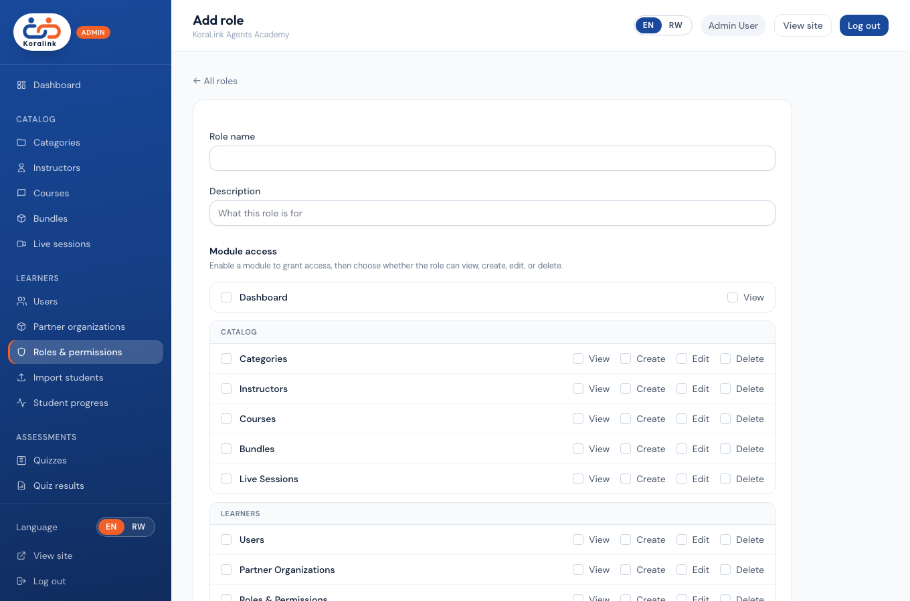

# Administrator Guide: Roles and Permissions

The admin panel uses roles and permissions to decide who can open which page and who can create, change or delete things. Open **Roles & permissions** in the Learners group to manage them.

## The model in brief

- The panel is divided into **modules** (Courses, Users, Quizzes and so on).
- Each module has up to four **actions**: **View**, **Create**, **Edit** and **Delete**. Some modules only offer some of them (see the matrix below).
- A **role** is a named set of module permissions, for example "Content editor".
- A user is given at most one role. The role decides what the user can do.
- Optionally a user can have **custom permissions** that replace the role's permissions for that person only.
- **Super Admin** is a built-in role that can do everything.

A person with no role is an ordinary learner and cannot open the admin panel.

## What the four actions allow

| Action | Typical effect |
| --- | --- |
| View | See the menu entry and the list and detail pages. Required for every other action in that module. |
| Create | Use the Add buttons and save new records. |
| Edit | Change existing records, including status switches such as Publish/Unpublish, Activate/Deactivate, regenerating a partner code, adding or removing courses in a bundle, and saving settings. |
| Delete | Delete records. For Settings, this is the permission to delete contact messages. |

When you tick Create, Edit or Delete for a module, View is switched on automatically, because the other actions cannot work without it.

## Permission matrix

An "X" means the action exists for that module. Modules and actions that are not offered cannot be granted.

| Module (menu entry) | View | Create | Edit | Delete |
| --- | --- | --- | --- | --- |
| Dashboard | X | | | |
| Categories | X | X | X | X |
| Instructors | X | X | X | X |
| Courses (includes sections and lessons) | X | X | X | X |
| Bundles | X | X | X | X |
| Live Sessions | X | X | X | X |
| Users | X | X | X | X |
| Partner Organizations | X | X | X | X |
| Roles & Permissions | X | X | X | X |
| Import Students | X | X | | |
| Student Progress | X | | | |
| Quizzes (includes questions) | X | X | X | X |
| Quiz Results (includes CSV export) | X | | | |
| Reports | X | | | |
| Settings (includes Contact messages) | X | | X | X |
| Partner Logos | X | X | X | X |
| Documentation | X | | | |

Notes on how pages map to actions:

- **Import Students**: opening the page needs View; Preview and Import need Create.
- **Courses**: sections and lessons are part of the Courses module. The list of enrolled learners used by live sessions needs View.
- **Quizzes**: adding a question needs Create, changing one needs Edit, deleting one needs Delete.
- **Settings**: the Settings page and the Contact messages inbox both need View; saving settings needs Edit; deleting messages needs Delete. Opening a message marks it as read.
- Learner-facing screens are not affected by these permissions.

## The Super Admin role

- Super Admin is a **system role**. It always has every permission in every module, its permissions cannot be reduced and it cannot be deleted.
- Assigning the Super Admin role switches on the user's **admin flag**; assigning any other role (or no role) switches it off. The admin flag is what makes a user a Super Admin, even if no role is shown. In practice you only need to choose the role; the flag follows automatically.
- Only a Super Admin can assign the Super Admin role or edit it.
- The last active Super Admin cannot be deleted, demoted or deactivated, so the platform is never left without an administrator.
- You cannot deactivate or delete your own account.

## Creating a role

1. Open **Roles & permissions** and choose **Add role**.
2. Enter the **Role name** and optionally a **Description** ("What this role is for"). The name must be unique.
3. Under **Module access**, enable the modules the role needs. For each enabled module tick View, Create, Edit and/or Delete.
4. Save. The role appears in the list marked "Custom role" (the built-in one is marked "System role").

The list shows each role's number of users and modules. Use **Edit** to change a role: changes apply to every user with that role straight away, except users who have custom permissions (below).

### Deleting a role

System roles cannot be deleted. When you delete a custom role, the users who had it lose their role and become ordinary students with no admin access, until you give them another role. The confirmation asks: "Delete this role? Assigned users will become students until you give them another role."

## Assigning a role to a user

1. Open **Users**, then **Edit** for the person (or **Add user** for a new one).
2. In **Role / access level**, choose the role. Choose "Student (no admin access)" to remove admin access.
3. Save.

The user form shows the role's permissions in the **Module access** section so you can see what the role grants.

## Custom permissions for one user

Use this when one person needs slightly different access from their role.

1. Edit the user and make sure a role is selected.
2. Tick **Customize module access for this user**.
3. Adjust the modules and actions.
4. Save.

Custom permissions **replace** the role's permissions for that person; they do not add to them. While custom permissions exist, later changes to the role do not affect that user. To go back to the role, untick the checkbox and save. Custom permissions are ignored for Super Admins, and are removed if the user has no role.

## What each kind of user can see

| User | Admin panel |
| --- | --- |
| Learner (no role) | No access. They see "Access denied". |
| Deactivated staff member | Cannot sign in. |
| Staff with a role | Only the menu entries for modules where the role has View. Buttons for Create, Edit and Delete appear only if granted. |
| Staff with custom permissions | Only what the custom list allows. |
| Super Admin | Every module and action. |

If a staff member opens a page for a module they cannot view, they see "You do not have permission to access this module." If the Dashboard is not in their permissions they are taken to the first module they can open.

## Suggested roles

These are examples only; the platform ships with Super Admin and you create the rest.

| Example role | Suggested permissions |
| --- | --- |
| Content editor | Categories, Instructors, Courses, Bundles, Quizzes: View, Create, Edit. No Delete. |
| Learner support | Users: View, Edit. Student Progress, Quiz Results: View. Contact messages (Settings): View. |
| Reports viewer | Dashboard, Reports, Student Progress, Quiz Results: View. |

Warning: The Users module lets its editors change a user's role and password. Anyone with Users: Edit can therefore give accounts (including their own) any role except Super Admin. Grant Users: Create and Edit, Delete and Roles & Permissions only to people you trust.
