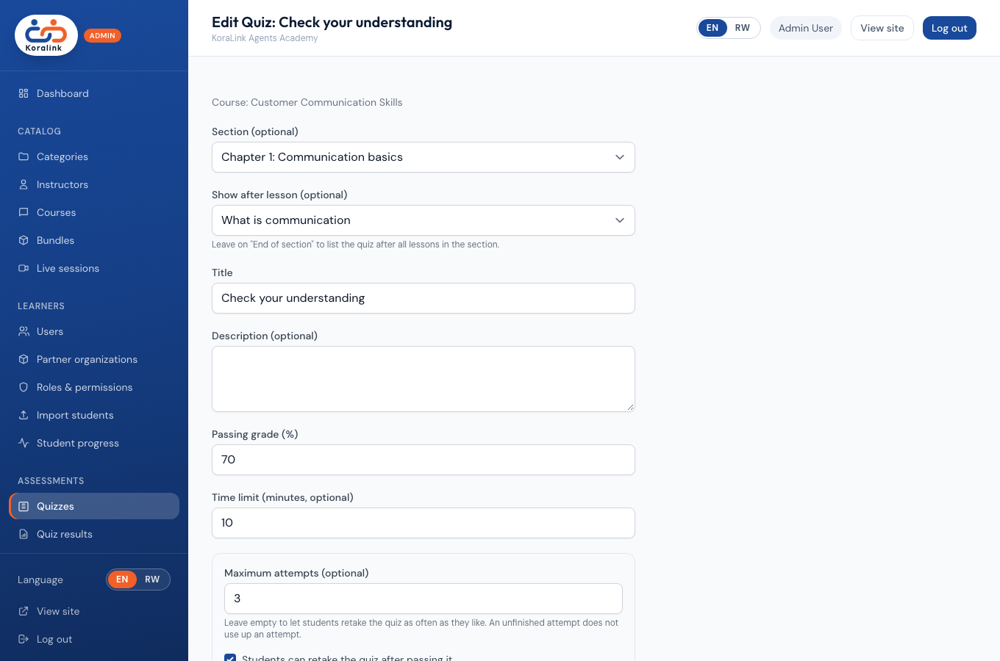

# Administrator Guide: Assessments (Quizzes and Results)

The **Assessments** group contains **Quizzes**, where you build quizzes and their questions, and **Quiz results**, where you review what learners submitted.

## Quizzes

### The quizzes list

Cards at the top show the number of Quizzes, Published quizzes, Questions and submitted Attempts. The list shows each quiz with its course, status (Published or Draft), passing percentage, time limit (if any) and number of questions. Search by quiz or course name, or filter by course.

Row buttons: **Questions**, **Edit** and **Delete** ("Delete this quiz and all its questions?"). Above the list, **View results** and **Export CSV** open the results (if you may view them) and **Create quiz** adds a new quiz.

### Creating a quiz

1. Open **Quizzes** and choose **Create quiz**.
2. Fill in the form:

| Field | Notes |
| --- | --- |
| Course | Required. Cannot be changed after the quiz is created. |
| Section (optional) | Place the quiz inside one section of the course. |
| Show after lesson (optional) | Place the quiz under a specific lesson of that section. |
| Title | Required. |
| Description (optional) | Shown to learners. |
| Passing grade (%) | A whole number from 0 to 100. Default 70. A learner passes when their percentage reaches this. |
| Time limit (minutes, optional) | 1 to 300. Leave empty for no limit. |
| Maximum attempts (optional) | 1 to 100. Leave empty for unlimited ("Unlimited"). |
| Students can retake the quiz after passing it | When off, a learner who has passed cannot start another attempt. On by default. |
| Published (visible to students) | When off, the quiz is a draft and learners do not see it. On by default. |

3. Optionally add the Kinyarwanda title and description (see the translation section in the "Reports, settings and messages" chapter).
4. Choose **Create quiz**, then open **Questions** on the new quiz to add questions.

Note: The quiz create form currently shows the Kinyarwanda translation section twice. Fill in only one of them.

### Placement: course, section or lesson

Where the quiz appears for learners depends on what you choose:

| Placement | How to set it |
| --- | --- |
| Whole course | Leave Section as "No section (general course quizzes)". |
| Section | Choose a Section and leave "Show after lesson" on "End of section". The quiz is listed after all lessons in that section. |
| Lesson | Choose a Section and then a lesson under "Show after lesson (optional)". The quiz appears under that lesson. |

The chosen section must belong to the course, and the lesson must belong to the chosen section; otherwise the form shows an error.

Tip: In a course where "Students must complete lessons in order" is on, a published quiz placed under a lesson holds back the next lesson until the learner has submitted that quiz. Learners do not need to pass it to move on.

### Attempt rules

- **Time limit**: when set, an attempt is closed automatically when time runs out and is submitted with the answers saved so far. It counts as a used attempt.
- **Maximum attempts**: counts submitted attempts. An unfinished attempt does not use one up, and learners can resume it.
- **Retake after passing**: see the table above.

### Editing and deleting

Use **Edit** to change any field except the course. Changes apply to new attempts. Deleting a quiz removes all its questions.

## Questions

Open a quiz's **Questions** page to see its question list (type, points, and the question text). Use **Add question** to add one, **Edit** to change one and **Delete** to remove one.

### Question types

| Type | How to set it up |
| --- | --- |
| Multiple choice (MCQ) | Enter at least two options and select the correct one with the radio button. Empty options are ignored. Exactly one option is correct. |
| True / False | Choose the **Correct answer**, True or False. The two options are created for you (with their Kinyarwanda wording "Ukuri" and "Ikinyoma"). |

Every question has the **Question text** (up to 2,000 characters) and **Points** (1 to 100). A quiz's score is the points earned out of the total points of all questions.

### Editing questions

- You can change the text, points and correct answer. The type cannot be changed after the question is created.
- For multiple choice you can edit existing option texts and add new options. On the edit page there is no button to delete an existing option; delete and recreate the question if you need fewer options.
- Each question and option has an optional Kinyarwanda translation.

Warning: Changing questions after learners have submitted attempts does not change their stored results.

## Quiz results

Open **Quiz results** to see every submitted attempt, newest first.

- Cards show Attempts, Passed, Failed and the Avg score.
- Filter by quiz (**All quizzes**) and result (**All results**, **Passed**, **Failed**), or search by student name, email, quiz or course. Press **Filter**; **Clear** resets.
- Each row shows the student, quiz, score, result and submission time.

### Result detail

Choose **View** on a row to open the attempt: the student, course and quiz, score, result, submission time and the **Answers** list. Each answer is marked Correct, Incorrect or No answer.

### Exporting to CSV

Choose **Export CSV** (on the Quizzes page or the Quiz results page). The file lists one submitted attempt per row with these columns: Student, Email, Course, Quiz, Score, Total, Percentage, Passed (Yes/No), Submitted At.

When you export from the Quiz results page, the search and filters you applied are included, so you can export just one quiz or only failed attempts. The Export CSV button on the Quizzes page exports all submitted attempts.

Only submitted attempts appear in results; unfinished attempts are not listed.
